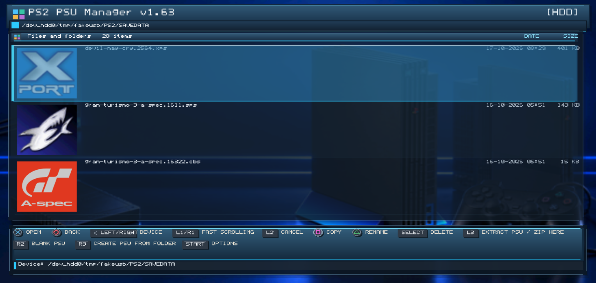
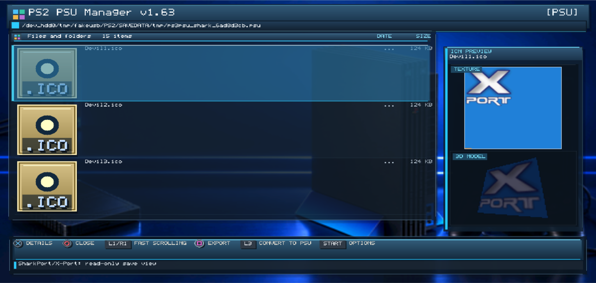
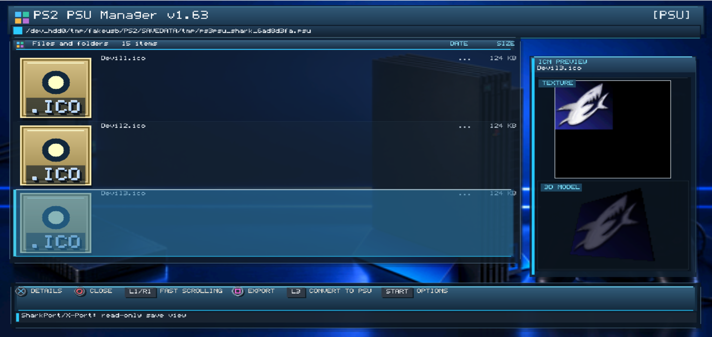
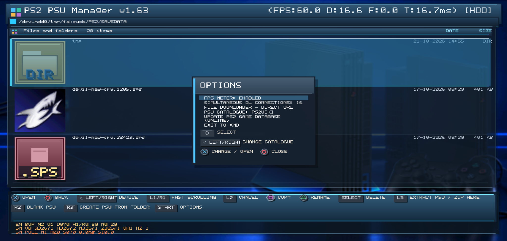
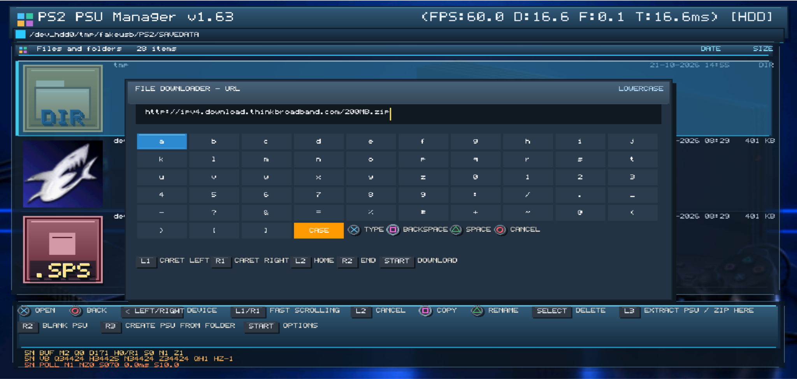
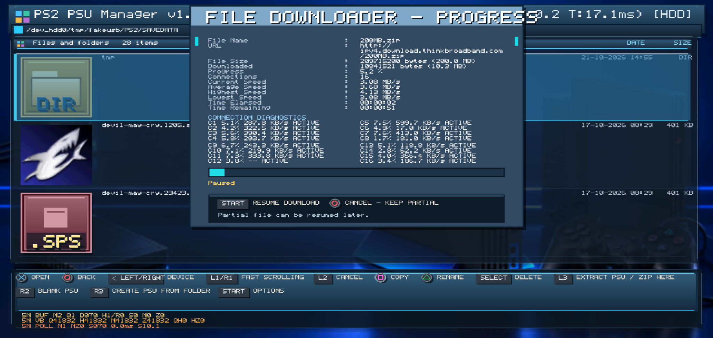
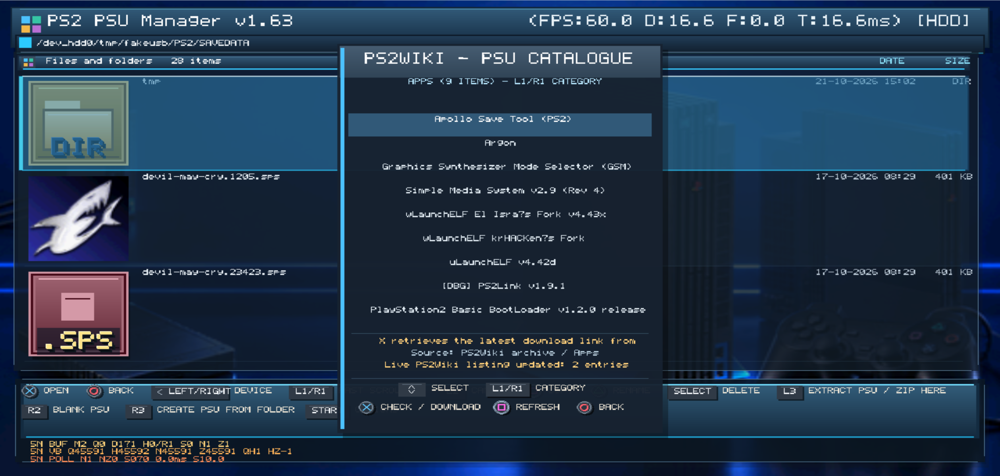

# PS3 PSU Manager

A PlayStation 3 homebrew application for managing PlayStation 2 memory-card saves without a PC, including browsing, inspecting, organising, extracting, creating and downloading save archives. Designed for compatible PS3 custom firmware, it preserves the original file format, filename and region when downloading saves.

> **Development status:** The latest GameFAQs integration has compiled but has not been validated against live GameFAQs responses or tested on real PS3 hardware. Opening saves is read-only; conversion is only performed when explicitly requested.

## Downloads

### Stable releases — v1.64

**[Download latest stable release](https://github.com/khant735/PS3-PSU-Manager/releases/latest)**

Official numbered releases. These are separate from experimental development builds. The latest stable release may not contain the newest experimental changes.

### Development builds — experimental prereleases

**[Browse the complete Development Builds index](docs/DEVELOPMENT_BUILDS.md)**

Each development build has a unique `dev-v?.??-build.RUN.ATTEMPT` tag and its own ELF, SELF, PKG and SHA-256 files. The index is automatically regenerated from GitHub releases after each successful build.

## Current capabilities

- File browser for PS3 HDD and USB paths, with file details and PS2 save archive inspection.
- PSU extraction to folders, PSU creation from folders and blank PSU templates.
- PS2 `.icn` save-icon previews, with experimental model/texture handling.
- Virtual keyboard for renaming files and archive entries.
- Read-only browsing of PSU, CBS, MAX, XPO, XPS and SPS save archives. XPO supports original-record listing, individual-file export and explicit experimental PSU conversion; other conversions vary by format.
- HTTPS file downloader with progress, pause/resume, partial-file retention and multi-connection diagnostics.
- Experimental homebrew and save catalogues (PS2Wiki/Filen, PS2HomebrewStore and GameFAQs, including preliminary Wayback Machine archive discovery), game-title metadata, regional release-date lookups and PS2IODB icon lookup.
- GameFAQs Saves: local catalogue, game/save ID parsing and Square-triggered listing scans and individual-save-page HTTPS retrieval. **Not** a complete live GameFAQs catalogue.
- RSX/Tiny3D interface, options, FPS display and exit-to-XMB action.

## Controls

Actions are screen-dependent. The on-screen footer is authoritative.

| Button | Typical action |
| --- | --- |
| D-pad | Move through menus, files and lists |
| Cross (✕) | Open / select / confirm |
| Circle (○) | Back / cancel |
| Triangle (△) | Context-specific menu/action |
| Square (□) | Context-specific action; GameFAQs listing scan, index reload or individual save-page fetch |
| L1 / R1 | Context-specific paging/navigation; R1 can move the keyboard caret |
| Start | Context-specific command as shown on screen |
| PS / Home | Open the PS3 system menu |

## Build from source

Install the [PS3DEV / PSL1GHT](https://github.com/ps3dev) PowerPC PPU toolchain and project dependencies. The source Makefile also uses Tiny3D, libfont, libcurl, mbedTLS, zlib and PS3 system libraries. Build on Linux with GNU Make and the toolchain's SELF/PKG utilities.

```sh
export PS3DEV=/opt/ps3dev
export PSL1GHT="$PS3DEV/psl1ght"
export PATH="$PS3DEV/bin:$PS3DEV/ppu/bin:$PATH"
make clean
make -j2
make pkg
```

The Makefile target is `ps3psumanager` and package title ID is `PSU000001`. When the required tools and assets are installed, expect `ps3psumanager.elf`, `ps3psumanager.self` and `ps3psumanager.pkg`. Refer to `Makefile` and `pkgfiles/` for the exact packaging requirements.

Host-side tests: `make host-test` (some tests require host mbedTLS development headers).

Install the PKG through the supported package installer on a compatible CFW PS3. **Back up saves before testing write or conversion operations.**

## Screenshots

### File browser:



### X-Port icon preview:



### SharkPort / GameShark icon preview:



### Options menu:



### URL keyboard:



### Downloader progress:



### Homebrew Catalogue:



*Additional features, including GameFAQs Saves, can be documented when screenshots become available.*

## Known limitations

- Live GameFAQs access and file URLs are not verified; the site may use restricted or dynamic downloads.
- GameFAQs listing discovery runs in a background worker; individual save-detail refresh remains synchronous and may temporarily delay the interface.
- Save formats other than PSU have varying levels of support.

## Source and licensing

This repository is intended to contain the current source, build files, tests and permitted assets. Review third-party asset licenses before redistribution. Keep generated ELF/SELF/PKG files in GitHub Releases rather than source control.
